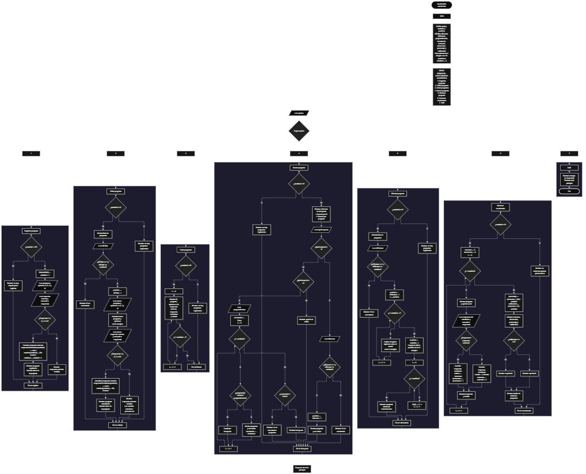

Este proyecto, llamado <b>cuestionario academico</b>, fue desarrollado en <b>visual basic .net</b> como un ejercicio práctico para fortalecer la lógica de programación mediante la creación de un sistema de administración y resolución de cuestionarios académicos desde la consola. El programa cuenta con un menú principal de siete opciones que permite <b>registrar, editar, eliminar, buscar, listar y resolver preguntas</b>, además de finalizar la ejecución. Cada pregunta almacena un enunciado, cuatro opciones de respuesta y su respuesta correcta, utilizando arreglos con una capacidad máxima de <b>10 preguntas durante la ejecución</b>. El sistema también permite guardar las respuestas del estudiante, identificar los aciertos y errores, calcular el porcentaje obtenido y determinar la calificación final sobre 5.0 para establecer si el estudiante aprueba o reprueba. Durante su desarrollo se aplicaron conceptos fundamentales de programación, como variables, arreglos, estructuras condicionales, ciclos repetitivos y estructuras de selección, además de procesos para buscar, modificar, eliminar y organizar registros. Este proyecto permite poner en práctica los conocimientos adquiridos en Visual Basic .NET y sirve como base para desarrollar sistemas de evaluación académica más avanzados.

<h2 align="center">⚙️ Funcionamiento del menú principal</h2>

### ➕ Registrar pregunta

La opción <b>1) registrar pregunta</b> permite agregar una nueva pregunta al cuestionario académico. Antes de realizar el registro, el programa comprueba que la cantidad de preguntas almacenadas sea menor a la capacidad máxima de los arreglos, utilizando la condición <b>cantidad &gt;= ids.Length</b>. Si no existe espacio disponible, muestra el mensaje <b>"no hay espacio para registrar mas preguntas."</b>, impidiendo agregar otro registro. En caso contrario, asigna un identificador mediante la expresión <b>ids(cantidad) = cantidad + 1</b> y solicita el enunciado de la pregunta, las cuatro opciones de respuesta y la respuesta correcta. Esta última se convierte a mayúsculas mediante <b>ToUpper()</b> y se comprueba que corresponda a las letras <b>A, B, C o D</b>, utilizando una estructura condicional <b>If...Else</b>. Si la respuesta es válida, el programa inicializa <b>respuestasEstudiante</b> con una cadena vacía y establece el estado como <b>"Sin resolver"</b>. Después, aumenta la variable <b>cantidad</b> en uno y muestra el mensaje <b>"pregunta registrada correctamente."</b>, junto con los datos del registro. Si la respuesta correcta no corresponde a ninguna de las cuatro opciones permitidas, muestra el mensaje <b>"la respuesta correcta debe ser A, B, C o D."</b> y no aumenta la cantidad de preguntas registradas.

### ✏️ Editar pregunta

La opción <b>2) editar pregunta</b> permite modificar la información de una pregunta previamente registrada. Primero, el programa comprueba si existen preguntas almacenadas mediante la condición <b>cantidad = 0</b>. Si no hay registros, muestra el mensaje <b>"no existen preguntas registradas."</b>. En caso contrario, utiliza un ciclo <b>For...Next</b> para recorrer los arreglos y mostrar los identificadores, enunciados, opciones y respuestas correctas de las preguntas existentes. Después, solicita el ID de la pregunta que se desea editar y comprueba que esté dentro del rango permitido mediante la condición <b>idEditar &gt;= 1 AndAlso idEditar &lt;= cantidad</b>. Si la selección es válida, calcula su posición mediante <b>posicion = idEditar - 1</b> y solicita el nuevo enunciado, las cuatro opciones y la nueva respuesta correcta. Esta última se convierte a mayúsculas y se comprueba que sea A, B, C o D. Si la respuesta es válida, actualiza el arreglo <b>respuestasCorrectas</b>, limpia la respuesta anterior del estudiante y restablece el estado a <b>"Sin resolver"</b>. Finalmente, muestra el mensaje <b>"pregunta actualizada correctamente."</b> junto con los datos modificados. Si la nueva respuesta no es válida, muestra el mensaje <b>"la respuesta correcta debe ser A, B, C o D."</b>, aunque los cambios realizados previamente en el enunciado y las opciones permanecen almacenados. Si el ID no corresponde a una pregunta registrada, presenta el mensaje <b>"ID no encontrada."</b>.

### 📋 Listar preguntas

La opción <b>3) listar preguntas</b> permite visualizar todas las preguntas registradas en el cuestionario académico. Antes de mostrar la información, el programa comprueba si la variable <b>cantidad</b> es igual a cero. Si no existen registros, presenta el mensaje <b>"no existen preguntas registradas."</b>. Si hay preguntas disponibles, utiliza un ciclo <b>For...Next</b> para recorrer los arreglos desde la primera posición hasta el total de preguntas registradas. Durante el recorrido, muestra el ID, el enunciado, las cuatro opciones, la respuesta correcta, la respuesta seleccionada por el estudiante y el estado de cada pregunta. Esta función facilita consultar toda la información almacenada y conocer cuáles preguntas todavía no han sido resueltas y cuáles ya cuentan con un resultado.

### 🔎 Buscar pregunta

La opción <b>4) buscar pregunta</b> permite localizar una pregunta mediante dos modalidades de búsqueda. Primero, el programa comprueba si existen preguntas registradas. Si no hay información almacenada, muestra el mensaje <b>"no existen preguntas registradas."</b>. En caso contrario, presenta un submenú con las opciones <b>1) buscar por ID</b> y <b>2) buscar por pregunta</b>. Cuando se selecciona la primera modalidad, solicita el identificador de la pregunta y comprueba que esté dentro del rango permitido mediante la condición <b>idBuscar &gt;= 1 AndAlso idBuscar &lt;= cantidad</b>. Si el ID es válido, calcula la posición mediante <b>posicion = idBuscar - 1</b> y muestra toda la información del registro. Cuando se selecciona la segunda modalidad, solicita un texto para buscar dentro de los enunciados e inicializa la variable lógica <b>encontrado</b> con el valor <b>False</b>. Después, utiliza un ciclo <b>For...Next</b> para recorrer las preguntas y comprobar las coincidencias mediante la condición <b>preguntas(i).ToLower().Contains(preguntaBuscar.ToLower())</b>. Cuando encuentra una coincidencia, muestra los datos de la pregunta y cambia <b>encontrado</b> a <b>True</b>. Si finaliza el recorrido sin encontrar coincidencias, presenta el mensaje <b>"no se encontraron preguntas."</b>. Si el usuario introduce un número diferente de las dos modalidades disponibles, muestra el mensaje <b>"opcion no valida."</b>.

### 🗑️ Eliminar pregunta

La opción <b>5) eliminar pregunta</b> permite eliminar una pregunta registrada mediante su identificador. Antes de comenzar, el programa comprueba que existan preguntas almacenadas. Si no hay registros, muestra el mensaje <b>"no existen preguntas registradas."</b>. Si existen preguntas, utiliza un ciclo <b>For...Next</b> para mostrar sus identificadores, enunciados, opciones y respuestas correctas. Después, solicita el ID de la pregunta que se desea eliminar y comprueba que esté dentro del rango permitido mediante la condición <b>idEliminar &gt;= 1 AndAlso idEliminar &lt;= cantidad</b>. Si la selección es válida, calcula la posición mediante <b>posicion = idEliminar - 1</b> y utiliza otro ciclo <b>For...Next</b> para desplazar una posición hacia atrás los datos de las preguntas posteriores en los nueve arreglos: <b>ids, preguntas, opcionA, opcionB, opcionC, opcionD, respuestasCorrectas, respuestasEstudiante y estados</b>. Posteriormente, disminuye la variable <b>cantidad</b> en uno y limpia la última posición ocupada de todos los arreglos. Finalmente, utiliza otro ciclo para renumerar los identificadores mediante <b>ids(i) = i + 1</b> y muestra el mensaje <b>"pregunta eliminada correctamente."</b>. Si el ID introducido no corresponde a una pregunta registrada, presenta el mensaje <b>"ID no encontrada."</b>.

### 📝 Resolver cuestionario

La opción <b>6) resolver cuestionario</b> permite presentar todas las preguntas registradas para que el estudiante seleccione sus respuestas y obtenga una evaluación académica. Primero, el programa comprueba si existen preguntas almacenadas mediante la condición <b>cantidad = 0</b>. Si no hay preguntas, muestra el mensaje <b>"no existen preguntas para resolver."</b>. En caso contrario, inicializa las variables <b>correctas</b> e <b>incorrectas</b> con el valor cero y muestra el título <b>"INICIO DEL CUESTIONARIO ACADEMICO"</b>. Después, utiliza un ciclo <b>For...Next</b> para recorrer todas las preguntas registradas y mostrar su enunciado junto con las opciones A, B, C y D. Para cada pregunta, solicita la respuesta del estudiante y convierte el texto introducido a mayúsculas mediante <b>ToUpper()</b>. A continuación, compara la respuesta del estudiante con la respuesta correcta utilizando una estructura <b>If...Else</b>. Si ambas respuestas coinciden, establece el estado como <b>"Correcta"</b> e incrementa la variable <b>correctas</b> en uno. Si no coinciden, establece el estado como <b>"Incorrecta"</b> e incrementa la variable <b>incorrectas</b> en uno. Después de cada comparación, muestra la respuesta seleccionada, la respuesta correcta y el estado obtenido. Cuando finaliza el recorrido, calcula el porcentaje de respuestas correctas mediante <b>(correctas * 100.0) / cantidad</b> y la calificación sobre 5.0 mediante <b>(correctas * 5.0) / cantidad</b>. Los resultados se presentan con dos decimales utilizando <b>ToString("0.00")</b>. Finalmente, el programa comprueba si la calificación es mayor o igual a <b>3.0</b>. Si cumple esta condición, muestra <b>"resultado: aprobado"</b>; de lo contrario, presenta <b>"resultado: reprobado"</b>. Para terminar, muestra el detalle de todas las respuestas, incluyendo el ID, el enunciado, la respuesta del estudiante, la respuesta correcta y el estado correspondiente.

### 🚪 Salir del menú principal

La opción <b>7) salir</b> está destinada a finalizar la ejecución del programa y muestra el mensaje <b>"gracias por utilizar Cuestionario Academico."</b>. El menú principal se encuentra dentro de una estructura repetitiva <b>Do...Loop While</b>, que mantiene el programa en funcionamiento mientras la opción seleccionada sea diferente de siete. La condición <b>opcion &lt;&gt; 7</b> permite finalizar el ciclo cuando el usuario selecciona la opción de salida. De esta manera, el programa termina correctamente después de mostrar el mensaje de despedida.

<h2 align="center">🧠 Temas aplicados en el proyecto</h2>

### 📦 Variables

En este proyecto se utilizan variables para controlar la cantidad de preguntas registradas, almacenar la opción seleccionada en el menú principal, identificar los registros que se desean editar, eliminar o buscar, controlar los recorridos de los arreglos y contabilizar los resultados obtenidos durante la resolución del cuestionario. También se utilizan variables de tipo lógico para determinar si una pregunta fue encontrada y variables numéricas para calcular el porcentaje y la calificación del estudiante. Cada variable cumple una función específica dentro de las operaciones de administración y evaluación académica.

🔢 **Opcion:** Almacena la opción seleccionada por el usuario en el menú principal.

📊 **Cantidad:** Controla el número actual de preguntas registradas.

🔄 **I:** Funciona como contador en los ciclos <b>For...Next</b> y permite recorrer las posiciones de los arreglos.

🔎 **IdEditar:** Almacena el identificador de la pregunta que se desea modificar.

🔎 **IdBuscar:** Almacena el identificador de la pregunta que se desea localizar.

🔎 **PreguntaBuscar:** Guarda el texto introducido por el usuario para buscar coincidencias en los enunciados.

🔎 **IdEliminar:** Almacena el identificador de la pregunta que se desea eliminar.

📍 **Posicion:** Determina la posición del arreglo correspondiente al identificador seleccionado.

✅ **Encontrado:** Variable lógica que indica si se encontró una pregunta durante la búsqueda por texto.

📝 **TipoBusqueda:** Almacena la modalidad de búsqueda seleccionada por el usuario.

📚 **Correctas:** Contabiliza la cantidad de respuestas correctas obtenidas por el estudiante.

❌ **Incorrectas:** Contabiliza la cantidad de respuestas incorrectas obtenidas por el estudiante.

📊 **Porcentaje:** Almacena el porcentaje de respuestas correctas del cuestionario.

🎓 **Calificacion:** Almacena la calificación final del estudiante sobre 5.0.

### 🗃️ Arreglos

En este proyecto se utilizan nueve arreglos paralelos relacionados con la información de las preguntas y las respuestas del estudiante. Cada arreglo tiene una capacidad de <b>10 posiciones</b> y utiliza el mismo índice para representar los datos correspondientes a una misma pregunta. Por ejemplo, la información de una pregunta almacenada en la posición <b>0</b> se encuentra distribuida entre <b>ids(0), preguntas(0), opcionA(0), opcionB(0), opcionC(0), opcionD(0), respuestasCorrectas(0), respuestasEstudiante(0) y estados(0)</b>. Esta organización permite registrar, consultar, modificar, eliminar y evaluar las preguntas de manera ordenada.

🔢 **Ids(10):** Almacena los identificadores numéricos de las preguntas registradas.

📝 **Preguntas(10):** Almacena los enunciados de las preguntas del cuestionario.

🅰️ **OpcionA(10):** Almacena el texto correspondiente a la primera opción de respuesta.

🅱️ **OpcionB(10):** Almacena el texto correspondiente a la segunda opción de respuesta.

©️ **OpcionC(10):** Almacena el texto correspondiente a la tercera opción de respuesta.

🆎 **OpcionD(10):** Almacena el texto correspondiente a la cuarta opción de respuesta.

✅ **RespuestasCorrectas(10):** Almacena las letras de las respuestas correctas de cada pregunta.

✍️ **RespuestasEstudiante(10):** Almacena las respuestas seleccionadas por el estudiante durante la resolución del cuestionario.

📋 **Estados(10):** Almacena el resultado individual de cada pregunta, que puede ser <b>"Sin resolver"</b>, <b>"Correcta"</b> o <b>"Incorrecta"</b>.

### 🔀 Estructuras condicionales

En este proyecto se utilizan las estructuras <b>If...Else</b> e <b>ElseIf</b> para controlar las diferentes condiciones de las operaciones del sistema. Estas estructuras permiten comprobar si existe espacio disponible antes de registrar una pregunta, verificar si hay registros almacenados, validar los identificadores seleccionados y comprobar que la respuesta correcta sea una de las cuatro opciones permitidas. También permiten comparar las respuestas del estudiante con las respuestas correctas, determinar si una pregunta fue encontrada y establecer si la calificación final es suficiente para aprobar el cuestionario. De esta manera, el programa puede ejecutar diferentes instrucciones según las condiciones de cada operación.

### 🔄 Estructuras repetitivas

En este proyecto se utilizan las estructuras repetitivas <b>Do...Loop While</b> y <b>For...Next</b>. El ciclo <b>Do...Loop While</b> mantiene activo el menú principal mientras el usuario no seleccione la opción siete. Por otro lado, los ciclos <b>For...Next</b> permiten recorrer los arreglos para mostrar las preguntas registradas, realizar búsquedas por texto, presentar las opciones durante la resolución del cuestionario y mostrar los resultados obtenidos. También se utilizan para desplazar los registros posteriores durante la eliminación de una pregunta y para renumerar los identificadores después de reorganizar los arreglos.

### 🎯 Estructura Select Case

El programa utiliza la estructura <b>Select Case</b> para evaluar el valor almacenado en la variable <b>opcion</b> y ejecutar las instrucciones correspondientes a cada selección del menú principal. Cada caso representa una operación específica del sistema: <b>registrar, editar, listar, buscar, eliminar, resolver cuestionario o salir</b>. También se utiliza el bloque <b>Case Else</b> para mostrar el mensaje <b>"opcion no valida."</b> cuando el usuario introduce un número que no coincide con ninguna de las opciones disponibles. Esta estructura permite organizar las operaciones del programa de manera clara y ordenada.

### 🔢 Dimensionamiento de arreglos

El programa utiliza la declaración de arreglos mediante la instrucción <b>Dim</b> para establecer la capacidad de almacenamiento de las preguntas y sus respectivos datos. Se definieron <b>10 posiciones</b> para cada uno de los nueve arreglos, utilizando índices desde <b>0 hasta 9</b>. La variable <b>cantidad</b> permite controlar el número de preguntas registradas y determinar las posiciones disponibles para nuevos registros. Además, se utiliza la propiedad <b>Length</b> del arreglo <b>ids</b> para comprobar la capacidad máxima antes de permitir el registro de otra pregunta.

### 🔄 Reorganización de registros

Cuando se selecciona una pregunta para eliminarla, el programa utiliza un ciclo <b>For...Next</b> que comienza en la posición seleccionada y llega hasta <b>cantidad - 2</b>. En cada repetición, los datos de la posición siguiente se copian sobre la posición actual en los nueve arreglos: <b>ids, preguntas, opcionA, opcionB, opcionC, opcionD, respuestasCorrectas, respuestasEstudiante y estados</b>. Después, la variable <b>cantidad</b> disminuye en uno y se limpian los datos de la última posición ocupada. Finalmente, otro ciclo recorre los registros restantes y actualiza los identificadores mediante <b>ids(i) = i + 1</b>. Este procedimiento permite mantener organizadas las preguntas y conservar la correspondencia entre todos los arreglos después de eliminar un registro.

### 🧮 Cálculos de resultados académicos

Durante la resolución del cuestionario, el programa utiliza las variables <b>correctas</b> e <b>incorrectas</b> para contabilizar los resultados obtenidos por el estudiante. Después de comparar cada respuesta, incrementa el contador correspondiente y actualiza el estado de la pregunta. Cuando termina el cuestionario, realiza dos cálculos principales. El primero determina el porcentaje de respuestas correctas mediante la fórmula <b>(correctas * 100.0) / cantidad</b>. El segundo obtiene la calificación sobre 5.0 mediante la fórmula <b>(correctas * 5.0) / cantidad</b>. Finalmente, compara la calificación con el valor mínimo de <b>3.0</b> para establecer si el resultado académico es aprobado o reprobado. Estos cálculos permiten presentar una evaluación general y un detalle individual de las respuestas.

<h2 align="center">¿Cómo se implementaron las operaciones crud en el proyecto?</h2>

Las operaciones <b>crud</b> se implementaron mediante las opciones del menú principal, permitiendo administrar las preguntas del cuestionario académico. La operación <b>crear</b> corresponde a <b>registrar pregunta</b>, donde se almacenan el enunciado, las cuatro opciones y la respuesta correcta; <b>leer</b> se realiza mediante las opciones <b>buscar pregunta y listar preguntas</b>, que permiten consultar los registros almacenados; <b>actualizar</b> corresponde a <b>editar pregunta</b>, donde se modifican los datos de una pregunta existente; y <b>eliminar</b> se realiza mediante la opción <b>eliminar pregunta</b>, que también reorganiza los arreglos para mantener los registros consecutivos. Adicionalmente, la opción <b>resolver cuestionario</b> utiliza la información almacenada para evaluar las respuestas del estudiante y generar los resultados académicos. Estas operaciones utilizan variables, arreglos, condicionales y ciclos para gestionar la información temporalmente durante la ejecución del programa.

<h2 align="center">Diagrama de flujo del proyecto</h2>

<h2 align="center">🛡️ Validaciones del programa</h2>

### 📭 No existen preguntas registradas

Esta validación se utiliza en las opciones de <b>editar, listar, buscar y eliminar</b>. El programa comprueba si la variable <b>cantidad</b> es igual a <b>0</b> y, si no existen preguntas registradas, muestra el mensaje <b>"no existen preguntas registradas."</b>. En la opción de resolver cuestionario, también comprueba si la cantidad de preguntas es cero y presenta el mensaje <b>"no existen preguntas para resolver."</b>. Estas comprobaciones evitan continuar con operaciones que necesitan información almacenada cuando el cuestionario está vacío.

### ⚠️ Capacidad máxima de preguntas

Esta validación se utiliza durante el registro de nuevas preguntas para controlar la capacidad máxima de los arreglos. El programa comprueba si <b>cantidad &gt;= ids.Length</b> antes de permitir agregar un nuevo registro. Si existe espacio disponible, solicita los datos de la pregunta y permite completar el registro cuando la respuesta correcta es válida. En caso contrario, muestra el mensaje <b>"no hay espacio para registrar mas preguntas."</b>, impidiendo agregar más registros mientras se mantenga ocupada la capacidad máxima de diez preguntas.

### ❌ Respuesta correcta no válida

Esta validación se utiliza durante el registro y la edición de preguntas. El programa convierte la respuesta introducida a mayúsculas mediante <b>ToUpper()</b> y comprueba que corresponda a una de las letras <b>A, B, C o D</b>, utilizando una condición con el operador lógico <b>OrElse</b>. Si la respuesta cumple con alguna de las opciones permitidas, el programa puede completar la operación correspondiente. De lo contrario, muestra el mensaje <b>"la respuesta correcta debe ser A, B, C o D."</b>. En el registro, una respuesta inválida impide aumentar la cantidad de preguntas; en la edición, los cambios realizados previamente en el enunciado y las opciones permanecen, aunque no se actualiza la respuesta correcta.

### 🔎 Pregunta no encontrada

Esta validación se utiliza durante las búsquedas por ID y por texto. Cuando se busca mediante un identificador, el programa comprueba que el valor introducido se encuentre entre <b>1</b> y <b>cantidad</b>. Si no corresponde a una pregunta registrada, muestra el mensaje <b>"ID no encontrada."</b>. Cuando se realiza una búsqueda por texto, inicializa la variable lógica <b>encontrado</b> con el valor <b>False</b> y recorre el arreglo <b>preguntas</b> para localizar coincidencias mediante <b>ToLower()</b> y <b>Contains()</b>. Si no encuentra ninguna coincidencia, presenta el mensaje <b>"no se encontraron preguntas."</b>.

### 🔢 Selección de preguntas mediante ID

El programa utiliza los identificadores para localizar las preguntas que se desean editar o eliminar. Antes de realizar estas operaciones, comprueba que el ID introducido sea mayor o igual a <b>1</b> y menor o igual al valor de <b>cantidad</b>. Cuando la selección es válida, calcula la posición correspondiente restando uno al identificador mediante <b>posicion = idEditar - 1</b> o <b>posicion = idEliminar - 1</b>. En la búsqueda por ID se utiliza el mismo procedimiento. Si el valor seleccionado está fuera del rango permitido, muestra el mensaje <b>"ID no encontrada."</b>. Esta validación evita acceder a posiciones que no corresponden a preguntas registradas.

### ⚠️ Opción inválida

La estructura <b>Select Case</b> incluye el bloque <b>Case Else</b>, que muestra el mensaje <b>"opcion no valida."</b> cuando el usuario introduce un número que no corresponde a ninguna de las siete opciones del menú principal. También se utiliza una comprobación en el submenú de búsqueda para informar cuando el usuario selecciona una modalidad diferente de buscar por ID o por pregunta. Estas condiciones permiten controlar las selecciones numéricas que no están contempladas en las opciones disponibles.

### 📝 Respuestas del estudiante

Durante la resolución del cuestionario, el programa convierte las respuestas introducidas por el estudiante a mayúsculas mediante <b>ToUpper()</b> y las compara con las respuestas correctas almacenadas. Si ambas coinciden, establece el estado como <b>"Correcta"</b>; de lo contrario, lo establece como <b>"Incorrecta"</b>. Sin embargo, el programa no comprueba que la respuesta introducida corresponda exclusivamente a las letras <b>A, B, C o D</b>. Por esta razón, cualquier otro valor introducido se contabiliza como una respuesta incorrecta.

<h2 align="center">🎯 Objetivo del proyecto</h2>

El objetivo principal de este proyecto es fortalecer la <b>lógica de programación</b> mediante el desarrollo de un sistema de administración y evaluación de cuestionarios académicos en <b>visual basic .net</b>. A través de su construcción se busca aplicar los conocimientos adquiridos sobre variables, arreglos, estructuras condicionales, ciclos repetitivos y estructuras de selección, integrándolos para resolver un problema de manera organizada. Además, el proyecto permite comprender cómo registrar, consultar, modificar y eliminar preguntas, así como evaluar respuestas, calcular porcentajes y obtener calificaciones académicas en una aplicación de consola. De esta manera, se establece una base para desarrollar sistemas de evaluación más completos utilizando otros lenguajes y tecnologías.

